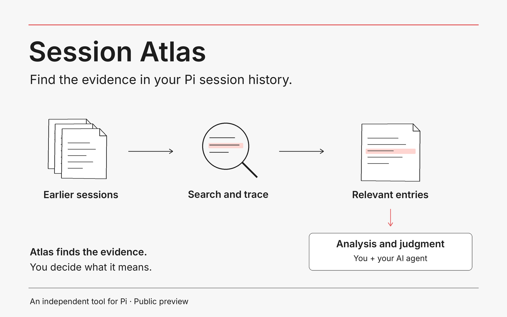

# Session Atlas: learn valuable lessons from your Pi session history

A lot of useful work happens inside an AI session. Thoughtful search and analysis can uncover lessons, recurring problems and ideas for what to build next. Session Atlas helps you discover and explore that material.

**Session Atlas gives [Pi](https://pi.dev) a structured way to search earlier sessions, trace files and commands, and return to exact entries.** It’s a Pi package with a local command-line tool and an agent skill. Atlas itself makes no LLM calls and leaves your source sessions unchanged.

I built it to recover earlier work, investigate recurring errors and bugs, and develop ideas for features and improvements. Session history becomes material to learn from, not just a record of what happened.



## Why this exists

Pi can already read its session files. If you know which conversation you need, that may be enough.

The harder questions span sessions: which attempts failed, where a file was discussed, which command worked, or whether the same problem keeps coming back. Atlas indexes a selected archive and provides queries for those tasks. You and Pi can inspect the relevant entries rather than repeatedly working through the raw files.

**Atlas finds the evidence. You and Pi make sense of it.** It does not automatically diagnose bugs or decide which features to build.

## Try it

After installing and indexing an archive using the steps below, ask Pi:

> Use Session Atlas to investigate recurring errors in this project's sessions. Show the relevant entries, distinguish repeated symptoms from possible causes, and suggest improvements. Don't change any files.

Or use the CLI directly. With `ATLAS` and `DB` set as below:

```bash
# Find a previous discussion
node "$ATLAS" search 'release notes' --db "$DB" --limit 5

# Follow references to a file
node "$ATLAS" trace --file notes.md --db "$DB" --limit 5

# Review recorded errors grouped by signature
node "$ATLAS" report errors --by signature --db "$DB"
```

Search and trace return matching session entries. The error report groups recorded errors for further investigation. An empty result is possible; none of these commands invents an answer when the archive has no match.

## Install and index

Use the reviewed `session-atlas-0.4.1.tgz` artifact and its checksum file when available from [GitHub Releases](https://github.com/6E6D/pi-session-atlas/releases). Version 0.4.1 is a maintenance preview with clearer cache-identity mismatch diagnostics and a concise cache-coverage check in the skill. The cache format is unchanged from 0.4.0. It is not an npm-registry release.

**Requirements:** Linux x64, Node 24.15.0 or a later Node 24 patch, and a trusted compatible Pi installation. The original compatibility baseline is Pi 0.85.1. Later checks cover synthetic Pi 0.87.0 compatibility and native skill discovery on Pi 0.87.1; they do not establish every workflow on those versions. macOS and Windows are not validated.

The 0.4.0 implementation also passes synthetic tests and isolated native skill discovery on Pi 1.2.0 with Node 24.15.0 on Linux x64. These checks are not a guarantee for every Pi version, workflow or deployment target.

### 1. Install the reviewed artifact

Verify the download against the release checksum. Replace the paths below with your downloaded artifact and a new, empty installation directory:

```bash
npm install --offline --ignore-scripts --omit=dev --no-audit --no-fund \
  --prefix /absolute/path/to/new-local-tools \
  /absolute/path/to/session-atlas-0.4.1.tgz
```

### 2. Make the skill available to Pi

```bash
pi install /absolute/path/to/new-local-tools/node_modules/session-atlas
```

This registers the package in your user Pi settings; add `-l` for project settings instead. Reload Pi or start a new session and verify that the intended `session-atlas` skill is loaded. Resolve any older same-name skill explicitly. Registration is optional for CLI-only use.

### 3. Index the sessions you want to search

Choose a session directory you are authorised to read and a new private cache path outside it. Indexing reads the whole selected directory, not just the project you intend to query.

```bash
ATLAS="/absolute/path/to/new-local-tools/node_modules/session-atlas/bin/atlas"
DB="/absolute/path/to/private-cache/atlas.db"
SESSIONS="/absolute/path/to/authorised-sessions"

node "$ATLAS" index --db "$DB" --sessions-dir "$SESSIONS" --json
```

Reuse those paths in the same shell for the examples. Check the returned coverage and warnings before treating a scan as complete.

### Keep the index current: two complementary options

**Periodic indexing.** Schedule the same index command with your operating system's scheduler, such as a systemd user timer on Linux. An hourly run is one option: it incrementally indexes changed sessions so recent work is usually available without a manual refresh. Scheduling is a separate setup step, not a service installed by Atlas. Give the job explicit session and cache paths and keep logs free of session content. A failed run should report the error, not automatically rebuild or change the selected archive.

**On-demand indexing through Pi.** The included skill tells Pi to inspect the cache's scan time, coverage and warnings. When a refresh is needed, Pi can run the index command once for the task if you have approved access to the complete selected session directory and writes to that cache, either for this request or under an existing standing permission. Otherwise it should ask. The skill guides this behaviour; it is not an automatic hook or a permission grant.

For example:

> Refresh the Session Atlas index for the session directory and cache I approved, then look for recurring errors in this project's recent sessions.

Use both approaches if helpful: a timer for routine updates, and a task-specific refresh for work since the last run. Queries themselves do not trigger indexing. Rebuilds and changes to the archive scope remain separate decisions.

## What you can investigate

| Task | Command |
|---|---|
| Find a discussion | `search 'release notes'` |
| Review recent requests without a keyword | `prompts --cwd "$SCOPE" --since "$START" --until "$END" --limit 20` |
| Match an exact phrase | `search 'exact phrase' --exact` |
| Follow file references | `trace --file notes.md` |
| Find recorded commands | `cmd 'test runner'` |
| Read a matching entry in context | `show SESSION ENTRY --context 2` |
| Get a source-checked citation | `cite SESSION ENTRY --verify-source` |
| Inspect unfinished-work candidates | `unfinished` |
| Inspect abandoned branches | `branches --abandoned` |
| Review recorded errors | `report errors --by signature` |
| Review recorded costs | `report cost --by model` |
| Review costs by day in a project scope | `report cost --by day --cwd "$SCOPE" --since "$START" --until "$END"` |
| Search context-edit records | `search 'query' --kind context_edit` |

Run commands through `node "$ATLAS"`, add `--db "$DB"`, and replace `SESSION` and `ENTRY` with returned identifiers. Add `--json` for structured output or use `--help` for options. Default search uses FTS token matching; use `--exact` for case-sensitive substrings or `--fts` for expressions such as `release OR rollout`.

## Recent-request reviews and scoped costs

`prompts` lists indexed user-role messages without a search term. It requires
`--since` and at least one of `--cwd`, `--dir` or `--session`; these selectors
are not access controls. For an already authorised scope and explicit window:

```bash
node "$ATLAS" prompts --db "$DB" --cwd "$SCOPE" \
  --since "$START" --until "$END" --limit 20 --json
node "$ATLAS" report cost --db "$DB" --by day --cwd "$SCOPE" \
  --since "$START" --until "$END" --model "$MODEL" --provider "$PROVIDER" --json
```

Set the variables to reviewed values. Omit the model/provider options when
all recorded attribution is wanted. Model/provider IDs are exact and
case-sensitive. Repeated values within one category combine with OR; distinct
categories combine with AND. Filters apply to each usage entry, including
standalone usage, consistently across totals, groups and top-session amounts.
Daily groups use UTC entry dates, not session-start dates. Unattributed usage
is not assigned to a guessed model or provider. Cwd is recorded session
location, not a verified project assignment; recorded costs are not invoices.

Prompt results are newest-first, with session UUID and entry ID tie-breaks.
Defaults are 20 messages and 1,200 Unicode code points per excerpt; permitted
limits are 1–100 messages and 1–2,000 code points through `--max-chars`.
Long messages stay eligible and are visibly truncated. Entries without indexed
text are labelled, not silently dropped. Counts and `hasMore` describe the
indexed selection, not all human requests or a representative sample. Results
are historical across branches; observed branch membership is not proof of
current model visibility or accepted intent. The command returns cited text
excerpts, not raw entries or image payloads, and never refreshes the cache.

A user-role message can be an agent-authored task or quoted material. Origin
must be assessed before inferring human preferences. Directory depth and
`parentSession` alone are not subagent classifiers. The packaged skill uses
bounded retrieval and surrounding evidence to propose responses to recurring
friction, including editing or removing instructions, software fixes or no
change. Semantic judgment stays outside the deterministic CLI; there is no
automatic instruction editing, memory promotion or background review.


## How it works

```text
Selected Pi sessions → local index → search, trace and reports
                                          ↓
                              original entries and citations
                                          ↓
                              your investigation with Pi
```

Atlas stores a derived SQLite index separately from the original sessions. Queries return recorded evidence and information about index coverage. The included skill guides Pi in using the CLI. There is no runtime extension, bundled model, vector service or background daemon.

## Limits and privacy

- **The archive is evidence, not ground truth.** Old answers and commands may be wrong or unsafe. File references do not necessarily explain why a change was made. Unfinished-work results are candidates, not obligations.
- **The index can be stale or incomplete.** Missing sessions cannot be recovered from citations. Source checking verifies identity and indexed size/mtime, not content hashes or factual correctness. Queries do not change logical Atlas records, but SQLite may coordinate reads through WAL/SHM metadata.
- **History is not an exact model-context replay.** Context edits are separately searchable; omitted originals remain in history. Atlas does not reconstruct every provider request.
- **Recorded cost is not a verified bill.** Usage reports include recorded standalone usage, but do not reconcile provider invoices.
- **Local retrieval does not make every later use local.** Atlas makes no LLM calls. If Pi sends retrieved text to a model, that follows your Pi configuration and data permissions.
- **Sessions and caches can contain secrets.** There is no automatic redaction or per-project access-control layer. Filters are not security boundaries. `show --context 0 --json` exposes full raw entries and should not be used for routine browsing or public examples.

Version 0.4.1 retains schema 4 / extraction 4. This patch alone does not require a cache rebuild. Older caches or changed parser identities need a deliberate rebuild or a new cache. Preserve the old cache if you need it; do not force a refused target, delete locks or relabel old data. Atlas refuses unsafe or unrecognised cache targets rather than repairing them automatically.

`CACHE_IDENTITY_MISMATCH` now lists changed fields and their stored/requested values. A Pi package-version change can block incremental refresh even when its parser-code fingerprint is unchanged. This is not evidence of corruption. The refusal and explicit rebuild gates are unchanged.

## Development and feedback

From a reviewed source checkout with the pinned development toolchain available:

```bash
npm run check     # typecheck, build and synthetic tests
npm pack          # prepack checks and runtime artifact
```

Useful feedback starts with a question you tried to answer and what happened. For bugs, provide a small synthetic reproduction, the Atlas/Pi/Node versions and sanitised diagnostics. **Do not upload your session archive or cache.** Discuss substantial changes first; there is no support SLA or stable internal library API.

## Licence

MIT, copyright 2026 Nima Maleki. See [LICENSE](LICENSE). The licence covers the distributed software and documentation, not your session data.
