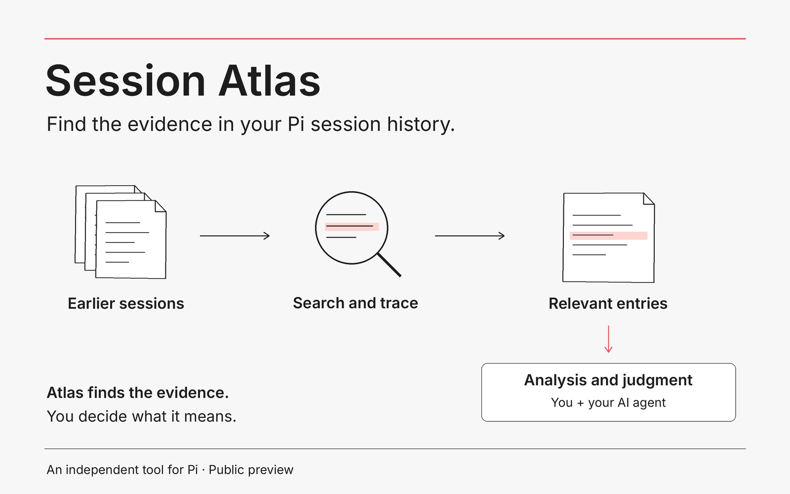

# Session Atlas: learn from your Pi session history

**Session Atlas gives [Pi](https://pi.dev) a structured way to find earlier work, investigate recurring problems and return to exact session entries.** It combines a local command-line tool with a Pi skill. Atlas makes no LLM or network calls and never writes your source sessions.

Use it when a question spans conversations: where a file was discussed, which attempts failed, what was decided, or which ideas deserve another look. Atlas retrieves the evidence; you and Pi interpret it. It does not automatically diagnose problems or decide what to build.



## Install

Download `session-atlas-0.5.2.tgz` and `SHA256SUMS` from [GitHub Releases](https://github.com/6E6D/pi-session-atlas/releases). This is a public preview, not an npm-registry release.

**Requirements:** Node 24.15.0 or a later Node 24 patch. Indexing requires an already installed, trusted Pi parser. The 0.5.2 source passes 198 synthetic tests, including offline installation and native skill discovery, on Linux x64 with Node 24.15.0 and Pi 1.4.0. Other Pi versions and operating systems need their own validation.

In the download directory, verify the checksum, then install into a new, empty directory. Replace the placeholder paths:

```bash
sha256sum -c SHA256SUMS
npm install --offline --ignore-scripts --omit=dev --no-audit --no-fund \
  --prefix /absolute/path/to/atlas-install \
  /absolute/path/to/session-atlas-0.5.2.tgz

pi install /absolute/path/to/atlas-install/node_modules/session-atlas
```

The last command registers the skill in your user Pi settings; add `-l` for project settings instead. Registration is optional for CLI-only use. Reload Pi or start a new session, and verify that the intended `session-atlas` skill is loaded rather than an older same-name copy.

## Configure and index

Keep host settings outside versioned installations so direct commands, the skill and scheduled jobs select the same cache and parser.

Create `${XDG_CONFIG_HOME:-~/.config}/session-atlas/host.json` with the following structure. Replace every placeholder with an absolute path; JSON values do not expand `~` or environment variables. Use a private directory (mode `0700`) and file permissions of `0600`.

```json
{
  "schemaVersion": 1,
  "cachePath": "/absolute/path/to/private-cache/atlas.db",
  "sessionsPath": "/absolute/path/to/authorised-sessions",
  "pathHome": "/absolute/path/to/session-owners-home",
  "piPackagePath": "/absolute/path/to/node_modules/@earendil-works/pi-coding-agent"
}
```

- Choose a cache outside the session directory. Indexing reads the **whole selected archive**, not just one project.
- `pathHome` is the home used to interpret recorded `~` paths, normally your home directory.
- `piPackagePath` selects executable parser code, so use a trusted Pi installation. Atlas does not download Pi.
- If upgrading, preserve your existing cache, archive, home and parser selections rather than guessing new ones.

Inspect the effective settings before the first index:

```bash
ATLAS="/absolute/path/to/atlas-install/node_modules/session-atlas/bin/atlas"
node "$ATLAS" config show --json
node "$ATLAS" index --json
```

Run indexing only after approving access to that archive and writes to its cache. Check the result for warnings or failures. Keep `ATLAS` set in the shell used for the examples below.

`config show` reports paths and their origins without opening sessions/caches or importing Pi. Precedence is **command options → existing ATLAS environment settings → host JSON → built-in defaults**. An absent default file retains legacy defaults, which may not point to your maintained cache. Invalid configuration fails rather than selecting another cache.

For a non-default file, add `--config /absolute/path/to/host.json` to every command. An explicitly selected file must exist. Atlas never creates host configuration automatically.

## Use it

After indexing, ask Pi:

> Use Session Atlas to investigate recurring errors in this project's sessions. Show the relevant entries, distinguish repeated symptoms from possible causes, and suggest improvements. Don't change any files.

Or use the CLI:

```bash
node "$ATLAS" search 'release notes' --limit 5 --json
node "$ATLAS" show SESSION ENTRY --context 2 --json
```

Replace `SESSION` and `ENTRY` with returned identifiers, and example paths/dates with your own. The table below omits the `node "$ATLAS"` prefix. Add `--json` for structured results; use each command's `--help` for its supported filters.

| Task | Command |
|---|---|
| Review recent requests in a project | `prompts --cwd /absolute/project/path --since YYYY-MM-DD --limit 20` |
| Follow file references | `trace --file notes.md --limit 10` |
| Find failed commands | `cmd 'npm test' --failed --limit 10` |
| Cite an entry and check its source identity | `cite SESSION ENTRY --verify-source` |
| Inspect unfinished-work candidates | `unfinished --limit 10` |
| Inspect abandoned branches | `branches --abandoned --session SESSION --limit 10` |
| Group recorded errors | `report errors --by signature` |
| Review recorded costs by day and project | `report cost --by day --cwd /absolute/project/path --since YYYY-MM-DD` |

Search normally matches FTS tokens. Use `--exact` for case-sensitive substrings or `--fts` for expressions such as `release OR rollout`. Dates use UTC unless a timestamp supplies an explicit timezone. Filters vary by command and are not access controls; commands without project scoping can return evidence from across the indexed archive.

## Keep the index current

Queries never refresh the index. Two complementary options are available:

- **Periodic:** schedule the index command with your operating system, for example an hourly systemd user timer. Set the Node executable or `PATH` explicitly and use `index --config /absolute/path/to/host.json` so the job requires your chosen configuration. Check for environment overrides with `config show` under the scheduled environment. Atlas installs no service or timer.
- **On demand:** ask Pi to refresh before investigating recent work. The skill checks cache coverage and may refresh only when your approval covers the complete archive and cache; otherwise it asks. Skill guidance is not an automatic hook or a permission grant.

An active timer is not proof of a successful scan. Check service logs, failures and query JSON's `cache.lastSuccessfulScan`. After changing Pi or repairing a job, verify a manual refresh and the next scheduled run. Logging is not notification. Never put `--rebuild` in a routine timer.

## Limits and privacy

- **History is evidence, not ground truth.** Old instructions may be unsafe; user-role text is not proof of human authorship. Unfinished-work results are candidates, recorded costs are not invoices, and context-edit history does not reconstruct exactly what a model saw.
- **Coverage matters.** An empty result from a stale or incomplete cache does not prove absence. Source verification checks identity and indexed size/mtime, not content hashes or factual correctness. Queries leave logical Atlas records unchanged, though SQLite may update WAL/SHM metadata.
- **Keep private data private.** Sessions and caches can contain secrets. There is no automatic redaction or per-project access isolation. `show --context 0 --json` exposes full raw entries; avoid it for routine browsing. If Pi sends retrieved text to a model, that follows your Pi configuration and permissions, not Atlas's local-only behaviour.
- **Do not force cache repairs.** Version 0.5.2 retains schema 4 / extraction 4 and does not itself require reindexing. Changed parser identities, older cache formats or archive bindings can require a deliberate rebuild or a new cache. `CACHE_IDENTITY_MISMATCH` names changed fields; it does not mean corruption. Preserve old data, and do not delete locks, relabel caches or bypass refusals.

## Development and feedback

From a source checkout with the pinned development toolchain available:

```bash
npm run check     # typecheck, build and synthetic tests
npm pack          # prepack checks and runtime artifact
```

Report bugs with a small synthetic reproduction, Atlas/Pi/Node versions and sanitised diagnostics. **Do not upload session archives or caches.** There is no support SLA or stable internal library API.

MIT, copyright 2026 Nima Maleki. See [LICENSE](LICENSE). The licence covers distributed software and documentation, not your session data.
